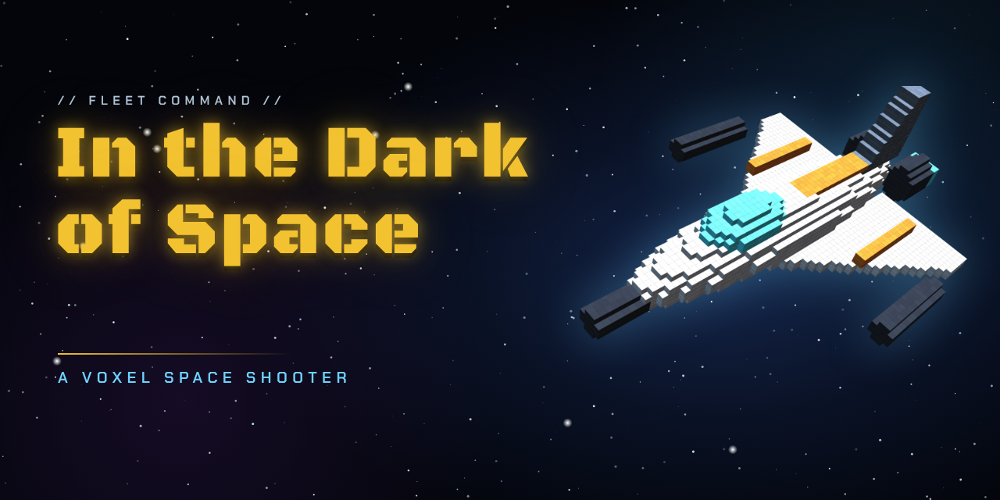
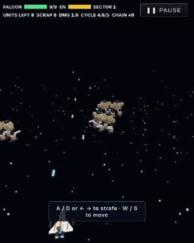

# In the Dark of Space

  

A Galaga-style voxel shooter with roguelike runs. You pilot the **Kestrel** (a tough mobile frame), the **Gale** (a fast interceptor) or the **Falcon** (a balanced strike fighter) and hold the line against mass-production units that fly in, form up and dive at you.
 
 

## Play
<h3 align="center">*Link to play*</h3>

 https://wut-lab.github.io/The-Dark-of-Space/

Enjoying it? A ⭐ on this repo helps other pilots find it.

 
 

## Info and Controls
Open `index.html` in a browser. It is a single file and loads Three.js from cdnjs.

- **Strafe:** `A`/`D` or the arrow keys. On touch, drag sideways.
- **Dash:** `Shift` or the Dash button. It uses EN and makes you briefly invulnerable.
- **Pause:** `Esc`, `P` or the Pause button.
- Your guns fire on their own.

Each sector is one wave. Destroy every unit (the **Units left** counter shows how many remain) to clear it, then pick a refit. Every 4th sector is a Bonus Stage. The run ends when your armor reaches zero.
 
 

## Files
- `index.html`: the game.
- `blueprint.html`: the build roadmap. Its saved notes and checkboxes only work when it's opened as a Claude artifact.

## Stats

<table>
<tr><td>Visits</td><td><b><!--TOTAL-->6<!--/--></b></td></tr>
<tr><td>Runs launched</td><td><b><!--launch-->1<!--/--></b></td></tr>
<tr><td>Pilots who made it home</td><td><b><!--home-->1<!--/--></b></td></tr>
<tr><td>Pilots lost to the Dark</td><td><b><!--lost-->1<!--/--></b></td></tr>
</table>

